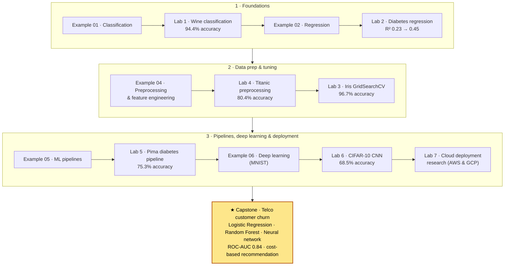

# Machine Learning and Deep Learning

Coursework from **ANLT-202: Machine Learning and Deep Learning**, part of the Business Information Systems program at Saskatchewan Polytechnic, Regina. The notebooks go from basic classification and regression, through preprocessing, tuning and pipelines, to cloud deployment and a capstone project that compares classical and deep learning models.

Every notebook runs in Google Colab. Open a notebook and click the **Open In Colab** badge at the top.

**Author:** Md Alamgir Hossain, PMP, CSM, ITIL v5 · [LinkedIn](https://www.linkedin.com/in/alamgircanb) · [pmport.ca](https://pmport.ca)


## Repository structure

```
Machine-Learning-and-Deep-Learning/
├── capstone/          ★ Final project – telecom customer churn prediction
├── labs/              Graded lab exercises 1–7 (my own work)
└── course-examples/   Guided course notebooks 01–06 that I worked through
```

| Folder | What's inside |
|---|---|
| [`capstone/`](capstone/) | The capstone project: classical ML vs deep learning for customer churn, with a business recommendation |
| [`labs/`](labs/) | Lab exercises 1–7. Each one is a completed assignment with code, results and written answers |
| [`course-examples/`](course-examples/) | The course's guided example notebooks for each module (classification, regression, preprocessing, pipelines, deep learning) |

## Course map



Interactive repository diagram: [view on GitDiagram](https://gitdiagram.com/hossain8078/machine-learning-and-deep-learning)

---

## At a glance

| # | Notebook | Topic | Dataset | Key result |
|---|---|---|---|---|
| 1 | [Wine classification](labs/Lab_1_Wine_Classification.ipynb) | Multiclass classification, EDA | Wine (scikit-learn) | 94.4% test accuracy (34 of 36) |
| 2 | [Diabetes regression](labs/Lab_2_Diabetes_Regression.ipynb) | Linear regression | Diabetes (scikit-learn) | R² from 0.23 (BMI only) to 0.45 (all features) |
| 3 | [Iris hyperparameter tuning](labs/Lab_3_Iris_Hyperparameter_Tuning.ipynb) | GridSearchCV, pipelines | Iris (scikit-learn) | 96.7% test accuracy (29 of 30) |
| 4 | [Titanic preprocessing](labs/Lab_4_Titanic_Preprocessing.ipynb) | Missing values, encoding, ColumnTransformer | Titanic (seaborn) | 80.4% accuracy, ROC-AUC 0.84 |
| 5 | [Pima diabetes pipeline](labs/Lab_5_Pima_Diabetes_Pipeline.ipynb) | Scaling, feature selection and tuning in one pipeline | Pima Indians Diabetes | 75.3% accuracy vs 64.9% baseline |
| 6 | [CIFAR-10 image classification](labs/Lab_6_CIFAR10_CNN.ipynb) | Convolutional neural network (Keras) | CIFAR-10 (Keras) | 68.5% test accuracy vs 10% chance |
| 7 | Cloud deployment research: [AWS](labs/Lab_7_Cloud_Deployment_Research_AWS.ipynb) · [GCP](labs/Lab_7_Cloud_Deployment_Research_GCP.ipynb) | PaaS vs CaaS vs FaaS | – | AWS: Elastic Beanstalk · GCP: Cloud Run |
| ★ | [**Capstone: customer churn**](capstone/Capstone_Telecom_Churn_Prediction.ipynb) | Classical ML vs deep learning | IBM Telco Customer Churn | ROC-AUC 0.84; cost-based recommendation |

The course examples I worked through are listed [further down](#course-example-notebooks).

---

## ★ Capstone Project – Predicting Telecom Customer Churn

**Notebook:** [`Capstone_Telecom_Churn_Prediction.ipynb`](capstone/Capstone_Telecom_Churn_Prediction.ipynb)

An end-to-end churn prediction project on the IBM Telco Customer Churn dataset (7,043 customers, 21 columns). It compares two classical machine learning models with a neural network and ends with a business recommendation.

**What the notebook covers**

1. **EDA and data cleaning.** It fixes `TotalCharges`, which was stored as text with 11 blank values. It also identifies the class imbalance (73.5% stay, 26.5% churn) and visualizes the main churn drivers.
2. **Preprocessing pipeline.** A `ColumnTransformer` scales numeric features and one-hot encodes categorical ones, on a stratified 80/20 split.
3. **Classical models.** Logistic Regression and Random Forest, each tuned with `GridSearchCV` (5-fold CV, F1 scoring, class weighting).
4. **Deep learning.** A Keras network with two hidden ReLU layers, Dropout, a sigmoid output, class weights and early stopping. Seeds are fixed so the results are reproducible.
5. **Model comparison.** Accuracy, precision, recall, F1, ROC-AUC, training time and ROC curves.
6. **Business impact.** Decision-threshold tuning based on an estimated cost of missed churners and retention offers.
7. **Recommendation** and answers to eight conceptual questions.

**Results (test set, 1,409 customers)**

| Model | Accuracy | Precision | Recall | F1 | ROC-AUC | Train time |
|---|---|---|---|---|---|---|
| Logistic Regression | 0.737 | 0.503 | **0.783** | 0.613 | **0.841** | **0.11 s** |
| Random Forest | **0.769** | **0.550** | 0.719 | **0.623** | 0.839 | 1.72 s |
| Neural Network | 0.744 | 0.512 | **0.783** | 0.619 | 0.838 | 19.62 s |

**Key findings**

- The strongest churn drivers are **month-to-month contracts, short tenure, fiber-optic internet, electronic-check payment and no tech support**.
- All three models perform almost the same (ROC-AUC within 0.003), so the choice comes down to cost, interpretability and complexity.
- With a cost-based threshold of 0.35 instead of 0.5, Logistic Regression catches **339 of 374 churners**. Under the stated assumptions, that cuts the estimated cost of churn by about **24%**.
- **Recommendation: Logistic Regression.** It matches the other models' performance, is fully interpretable through its coefficients and odds ratios, and is the simplest to deploy and maintain.

---

## Lab exercises

### Lab 1 – Classification with the Wine dataset
[`Lab_1_Wine_Classification.ipynb`](labs/Lab_1_Wine_Classification.ipynb)

Predicts the wine cultivar (3 classes) from 13 chemical measurements. The notebook explores the data, visualizes how separable the classes are, and trains and evaluates a decision tree classifier. **Result:** 94.4% test accuracy, with only 2 errors out of 36 samples.

### Lab 2 – Regression with the Diabetes dataset
[`Lab_2_Diabetes_Regression.ipynb`](labs/Lab_2_Diabetes_Regression.ipynb)

Predicts diabetes progression one year after baseline. It compares a linear regression that uses BMI only with one that uses all 10 features, on the same train/test split. **Result:** MSE falls from 4,062 to 2,900 and R² rises from 0.23 to 0.45.

### Lab 3 – Hyperparameter tuning for classification
[`Lab_3_Iris_Hyperparameter_Tuning.ipynb`](labs/Lab_3_Iris_Hyperparameter_Tuning.ipynb)

Builds a `StandardScaler` + `RandomForestClassifier` pipeline and tunes `n_estimators`, `max_depth` and `min_samples_split` with `GridSearchCV` (36 combinations, 5-fold CV). The test set is kept out until tuning is finished. **Result:** 95.8% cross-validated accuracy and 96.7% on the held-out test set.

### Lab 4 – Preprocessing a real-world dataset
[`Lab_4_Titanic_Preprocessing.ipynb`](labs/Lab_4_Titanic_Preprocessing.ipynb)

Handles missing ages and ports using statistics from the training set only, drops a sparse column, and scales and encodes features with a `ColumnTransformer` before a Logistic Regression classifier. **Result:** 80.4% test accuracy, 0.78 balanced accuracy and ROC-AUC 0.84.

### Lab 5 – Building a comprehensive pipeline
[`Lab_5_Pima_Diabetes_Pipeline.ipynb`](labs/Lab_5_Pima_Diabetes_Pipeline.ipynb)

A full pipeline (`StandardScaler` → `SelectKBest` → `RandomForestClassifier`) tuned end to end with `GridSearchCV` (18 combinations, 90 CV fits). Keeping every step inside the pipeline prevents data leakage. **Result:** 77.7% cross-validated accuracy and 75.3% on the test set, against a 64.9% majority-class baseline.

### Lab 6 – Image classification with a CNN
[`Lab_6_CIFAR10_CNN.ipynb`](labs/Lab_6_CIFAR10_CNN.ipynb)

Classifies 32×32 colour images into 10 classes (airplane, car, bird, cat, and so on) with a Keras convolutional neural network: three `Conv2D` layers, two `MaxPooling2D` layers, `Flatten`, a `Dense` layer and a softmax output (122,570 parameters). It is trained for 10 epochs with Adam and sparse categorical cross-entropy, and the notebook plots the learning curves, prints a per-class report and shows sample predictions. **Result:** 68.5% test accuracy (6,853 of 10,000 images), against 10% for random guessing. Trucks, frogs and ships are recognized best and cats worst. After about epoch 5, validation loss stops improving while training loss keeps falling, an early sign of overfitting.

### Lab 7 – Researching cloud deployment options
[`Lab_7_Cloud_Deployment_Research_AWS.ipynb`](labs/Lab_7_Cloud_Deployment_Research_AWS.ipynb)

A research report comparing three ways to serve a Flask-wrapped scikit-learn model on AWS:

| Model | AWS service |
|---|---|
| PaaS | Elastic Beanstalk |
| CaaS | Amazon ECS on Fargate |
| FaaS | AWS Lambda |

The report covers features, the deployment steps, cost and the trade-offs between them. **Recommendation:** Elastic Beanstalk for a small model, because it is the simplest path to production.

[`Lab_7_Cloud_Deployment_Research_GCP.ipynb`](labs/Lab_7_Cloud_Deployment_Research_GCP.ipynb) is a second report that does the same comparison on Google Cloud: App Engine (PaaS), Cloud Run (CaaS) and Cloud Run functions (FaaS). **Recommendation:** Cloud Run. It scales to zero, so a small app costs little or nothing, it runs the existing Flask app unchanged in a container, and it has no library or size limits.

---

## Course example notebooks

These are the course's guided examples, which I worked through and extended.

| Notebook | Topic |
|---|---|
| [`01_Classification_Example.ipynb`](course-examples/01_Classification_Example.ipynb) | Introduction to classification on Iris: decision tree (93.3%), KNN (96.7%) and Logistic Regression (96.7%) compared with confusion matrices and reports |
| [`02_Regression_Example.ipynb`](course-examples/02_Regression_Example.ipynb) | Introduction to regression on California Housing: Linear, Ridge and Lasso regression compared with MSE, RMSE, MAE and R² (best R² 0.58) |
| [`04_Preprocessing_Feature_Engineering.ipynb`](course-examples/04_Preprocessing_Feature_Engineering.ipynb) | Missing-value analysis, imputation, encoding and feature engineering on the Titanic data (84% pipeline accuracy), plus a leakage-aware comparison and ideas for further work |
| [`05_Pipelines.ipynb`](course-examples/05_Pipelines.ipynb) | Pipelines with `ColumnTransformer`, tuning, data leakage, imbalanced data, saving models, custom transformers and ensembles |
| [`06_Deep_Learning.ipynb`](course-examples/06_Deep_Learning.ipynb) | Introduction to deep learning on MNIST handwritten digits: a dense neural network (98.0% test accuracy) compared with a simple CNN (98.1%), with training curves and misclassified examples |

---

## Skills demonstrated

- **Data preparation:** EDA, missing-value handling, encoding, scaling, feature selection and engineering
- **Modeling:** decision trees, Random Forest, Logistic and Linear Regression, neural networks and CNNs (Keras)
- **Model selection:** `Pipeline`, `ColumnTransformer`, `GridSearchCV`, cross-validation, preventing data leakage
- **Evaluation:** accuracy, precision, recall, F1, ROC-AUC, MSE/R², confusion matrices, baselines
- **Business framing:** cost-based thresholds, interpretability trade-offs, cloud deployment options (AWS, GCP)

## Tools and libraries

Python · pandas · NumPy · Matplotlib · seaborn · scikit-learn · TensorFlow / Keras · Google Colab · AWS and Google Cloud (research)

## How to run

Open any notebook in Google Colab with its badge, then choose **Runtime → Run all**. All datasets load from public URLs or from scikit-learn and seaborn, so you don't need to download anything.
